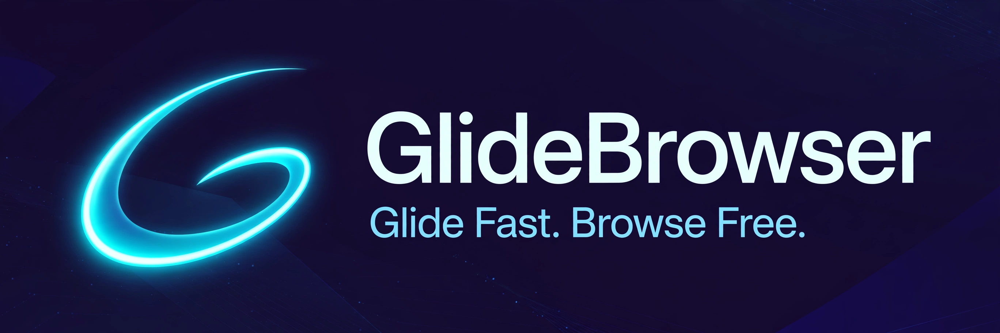

# GlideBrowser — by Shivam Bhalla (@shivytyahoo)



> **Glide Fast. Browse Free.** — halka, fast, private browser. No ads, no trackers, just glide.


## Build status (2026-11-27)

Kaam shuru — poora app code likha ja chuka hai: shared core (EasyList, HLS, DNS, VPN config), Android WebView + tabs/history/bookmarks/downloads + Settings/About, Windows Compose Desktop shell. **Is machine pe Java/Android SDK nahi hai, isliye APK yahan compile nahi hua** — GitHub Actions (`.github/workflows/build.yml`) se Android APK + Windows MSI banega. Wahi reliable rasta hai jo YouGlideTube me bhi use hua tha.

Ek chhota, fast, private web browser — **Android + Windows PC** ke liye, scratch se Kotlin me.

- **Android:** Kotlin + Jetpack Compose + **Material 3** (M3 Expressive nahi, stable M3 tokens only — no gradient, no glassmorphism, no hardcoded `Color(0xFF...)`, YouGlideTube wali house style)
- **Windows:** Compose Multiplatform (Desktop) + **WebView2** (Edge runtime, Windows 10/11 me pehle se hota hai — isiliye installer chhota rehta hai, Chromium bundle nahi karte)
- **Engine:** Android pe system WebView, Windows pe WebView2. Apna Chromium fork **nahi** banaya — wahi wajah hai jisse APK chhota rehta hai (Cromite/Firefox fork 150 MB+ hote hain).

## Kya-kya andar hai

| Feature | Kaise |
|---|---|
| **Stealth AdBlocker** | `S-AdShield` ka port — DNS + request level. 250k+ domains (StevenBlack, HaGeZi Multi PRO, uBlock DNS). Blocked domain ko `10.10.10.3` stub se empty-but-valid jawab — site ko pata nahi chalta adblock hai (Anti-Detect). `shouldInterceptRequest` me empty response, cosmetic CSS se khaali ad slots collapse, bait elements ko chhedo mat. |
| **In-built VPN — IPChakra** | WARP (WireGuard) + OpenVPN + Xray Stealth (VLESS + Reality, Hysteria2, Trojan, Shadowsocks). Sirf verified connect — DNS + exit-IP probe pass hone ke baad hi “Connected”. 30s watchdog, self-healing. Android pe ek hi `VpnService` chal sakta hai, isliye AdBlock + VPN ek hi tunnel me: V2Ray me `dns.hosts -> 0.0.0.0`, WireGuard/OpenVPN me ad-blocking DNS. |
| **Video Downloader** | Aloha / Soul / Via / Pawxy jaisa — `shouldInterceptRequest` + JS bridge se `.mp4/.webm/.m3u8/.mpd/.mp3` sniff karo, floating “N media” chip, quality picker, HLS segments download karke MP4 me stitch karo. DRM wali / YouTube ki protected streams bypass **nahi** karte — sirf woh content jo site khud openly serve karti hai. |
| **DNS change** | 27 providers (Cloudflare 1.1.1.1, Quad9, AdGuard, NextDNS, Control D, CleanBrowsing…), DoH/DoT + Custom DNS. Jo DNS actually use ho raha hai, Home card pe dikhta hai. |
| **Tabs, History, Bookmarks, Downloads, Incognito, Reader mode, Dark/Light + Dynamic color** | DataStore + Room, Material 3 |

## GitHub bases — kahan se help li (copy-paste nahi, reference)

Aloha, Soul Browser, Via Browser aur Pawxy **closed-source** hain — unka code GitHub pe nahi hai, isliye unhe copy nahi kiya. Unka *behaviour* open-source projects se samajh kar implement kiya hai:

- **FOSS Browser** (`saschpe/FOSS-Browser`) + **Lightning Browser** (`anthonycr/Lightning-Browser`) — halka WebView browser architecture, small APK ka reference
- **Privacy Browser** (`stoutner/PrivacyBrowserAndroid`) — EasyList parsing (`||domain`, `@@allow`, `domain=` rules)
- **Cromite** (`uazo/cromite`) + **DuckDuckGo Android** (`duckduckgo/Android`) — ad/tracker blocking reference, **fork nahi kiya** (size ki wajah se)
- **QuickTube** (`devgalib/QuickTube`) — Compose M3 + NewPipe Extractor + yt-dlp, HLS-to-MP4, WebView me video detection
- **super-video-downloader** (`alexch33/super-video-downloader`) — `shouldInterceptRequest` + ServiceWorker se m3u8/mpd detection, segmented downloader
- **HaizhuBrowser** (`HaizhuAI/HaizhuBrowser`) — resource sniffer + m3u8 downloader, Android + Windows dono
- **Pull** (`aiyu-ayaan/Pull`) — “N media” sniffer chip + 3-layer shield ka pattern
- **Candy Browser** (`sk2andy/candy-browser`) + **Eddy** (`arcbaseproject/Eddy`) — Compose M3 Expressive browser UI reference

Apne projects:
- **S-AdShield:** https://github.com/shivytyahoo/S-AdShield — DNS adblocker, Kotlin, v1.2.0
- **IPChakra:** https://github.com/shivytyahoo/IPChakra — VPN, Dart/Flutter, WARP + Xray
- **Author GitHub:** https://github.com/shivytyahoo

> Aloha/Soul/Via jaisa video downloader kaise kaam karta hai, poora analysis `docs/VIDEO_DOWNLOADER.md` me hai. Stealth adblock ka analysis `docs/STEALTH_ADBLOCK.md` me hai.

## Size — chhota kaise rakha

- System WebView / WebView2 use karo — Chromium bundle mat karo (~100 MB bachta hai)
- R8 full mode + `shrinkResources`, ABI split (`arm64-v8a` alag, `armeabi-v7a` alag), `resConfigs en,hi`
- No heavy libs: OkHttp + DataStore + Room only. ExoPlayer/Media3 sirf in-built player ke liye, optional module me
- Target: **Android APK ~9–12 MB** (arm64, release, R8), **Windows installer ~18–25 MB** (WebView2 runtime alag se, already installed hota hai)

## Build

```bash
# Android (JDK 17, Android SDK 34+)
./gradlew :androidApp:assembleRelease
# -> androidApp/build/outputs/apk/release/

# Windows (JDK 17)
./gradlew :desktopApp:packageMsi   # ya packageExe
# -> desktopApp/build/compose/binaries/main/msi/
```

> Is machine pe abhi `java` nahi hai, isliye yahan APK build nahi hua — upar wale commands Android Studio / GitHub Actions me chalenge. GitHub Actions workflow `/.github/workflows/build.yml` me hai (wahi pattern jo YouGlideTube me use hua).

## Structure

```
shared/          commonMain — AdBlock, DNS, VPN contract, VideoSniffer, Settings (platform-agnostic)
androidApp/      Compose M3 UI + WebView + VpnService (S-AdShield) + DownloadManager
desktopApp/      Compose Desktop UI + WebView2 bridge (Windows)
docs/            VIDEO_DOWNLOADER.md, STEALTH_ADBLOCK.md, VPN_INTEGRATION.md
```

## License / Note

Sirf woh video download karo jiska haq tumhare paas ho ya jo site allow karti hai. DRM bypass nahi karte.
